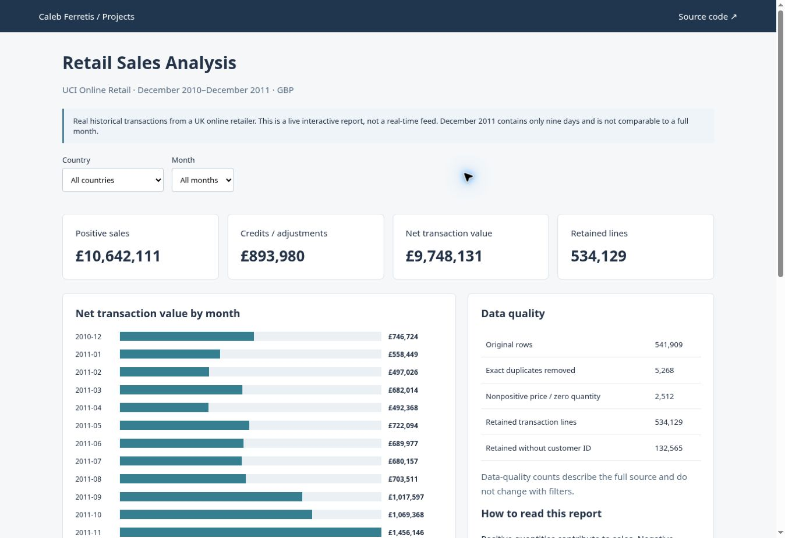

# Retail Sales Analysis

Real historical retail transactions analyzed with Python and SQL, with an interactive browser report.

**Python · SQL · SQLite · Data validation · JavaScript**

[Live dashboard](https://lacetears.github.io/it-career-portfolio/sales.html) · [Methodology and source](retail/README.md) · [SQL](retail/queries.sql)



*Screenshot of the published interactive demo.*

## The question
How do sales and credits vary by country and month, and how much does cleaning change the input? This project uses UCI's Online Retail dataset, not generated company revenue.

## Findings
- 541,909 original rows become 534,129 retained transaction lines after the documented exclusions.
- Positive sales total £10,642,110.80; credits/adjustments total £893,979.73.
- Net transaction value is £9,748,131.07 under the stated rounding and cleaning rules.
- December 2011 is incomplete, so a direct comparison with November would be misleading.

The dataset spans December 2010 through December 2011. The report is live on the web; the data is historical, not a continuously updating feed. No profit is calculated because the source contains no costs.

## Run the real-data pipeline
```sh
python -m pip install -r requirements.txt
python retail/download.py
python retail/analyze_retail.py "retail/source/Online Retail.xlsx"
python -m pytest -q
```
Open `retail/output/dashboard.html` locally, or use the live link. [Inspect the saved aggregate data](retail/output/report.json).

## Source and attribution
Chen, D. (2015). Online Retail. UCI Machine Learning Repository. https://doi.org/10.24432/C5BW33. CC BY 4.0. This analysis removes exact duplicate rows, excludes nonpositive prices and zero quantities, retains signed adjustments, and aggregates the resulting transactions. Customer IDs are omitted from published output.

## Additional synthetic exercise
The `data-analytics/` folder retains the earlier synthetic electronics-sales pipeline for testing cleaning, discounts, and known-error fixtures. Its numbers are separate from the real-data report. [Synthetic exercise documentation](data-analytics/README.md).

[Development notes](docs/development.md)
